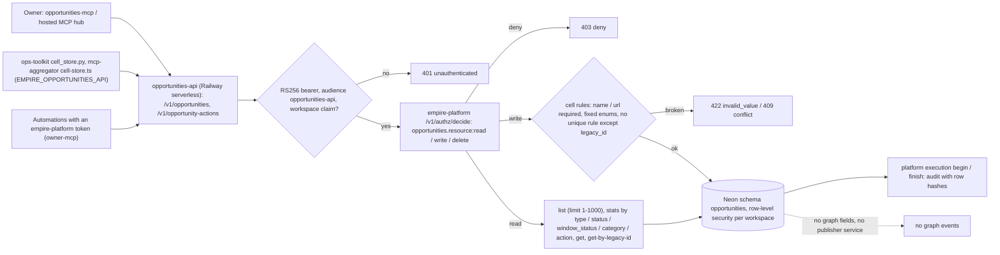

# 01 — Business process (As-Is / To-Be)

life-opportunities-api คือ cell "Opportunities" ที่เก็บโอกาสทางธุรกิจที่ owner กำลังศึกษา (ชนิด, สถานะ, คะแนน 7 ด้าน, คะแนนรวม, ช่วงเวลาตลาด) และ opportunity actions (URL ที่เห็น พร้อม trend score และการตัดสินใจ act_on / skip / monitor กับรายได้คาดหวังและจริง) owner และ automation เรียกผ่าน API ด้วย token ของ empire-platform; cell นี้ไม่มี publisher และไม่ส่ง graph events

Last reviewed: 2026-11-27 · commit `0d270c6`

## As-Is (จากโค้ดวันนี้)

Sources: `cell.yaml`, `.railway/railway.ts`, `pyproject.toml` (platform-cellkit v1.0.11: `cellkit/app.py`, `cellkit/auth.py`, `cellkit/server.py`), `README.md`, `PRODUCT.md`

ข้อเท็จจริงสำคัญจากโค้ด:

- `.railway/railway.ts` มีแค่ service `opportunities-api`; `cell.yaml` ไม่มี `graph` บน resource ใด จึงไม่มีแถวใน outbox
- ไม่มีการจำกัดช่วงของ level, tier หรือคะแนน และ `total_score` ไม่ได้คำนวณจาก level (ผู้เรียกส่งมาเอง); `revenue_actual` / `revenue_expected` เริ่มที่ 0
- การสร้างแบบ import (มี `legacy_id`) ต้องมีสิทธิ์ `opportunities.<resource>:admin` เพิ่มจาก `:write`; create รับ `Idempotency-Key`, patch ใช้ `expected_version`
- owner token (ไม่มี delegation) อายุได้ไม่เกิน 1 ชั่วโมง, delegated token ไม่เกิน 30 วัน
- การตรวจ `X-Gateway-Assertion` (edge gateway) เปิดตาม `GATEWAY_ASSERTION_MODE`; ค่าใน production [ต้องยืนยัน]

## To-Be (จาก PRODUCT.md §Measures)

ไม่มี spec ที่ค้างอยู่ (`specs/001-l2-baseline` และ `specs/002-cellkit-test-depth` implement แล้ว) และไม่มีภาพกระบวนการเป้าหมายที่เขียนไว้ สิ่งที่เขียนไว้มีเพียง measures ที่ "Proposed, nothing collects them yet":

- จำนวนโอกาสต่อสถานะ (stats grouped by `status`)
- สัดส่วน action ที่เป็น act_on และมี `revenue_actual` ไม่เป็นศูนย์
- 5xx rate และ p95 latency ของ `/v1/opportunities` (Sentry และ uptime worker)

## Gap

| ID | As-Is → To-Be | Status | Owner | Evidence |
|---|---|---|---|---|
| G1 | platform ตอบ 403 ด้วย body ที่ไม่ใช่ JSON แล้ว API ตอบ 500 (strict xfail ใน SPEC-002) → เป็น denial ปกติ | done | claude | `specs/002-cellkit-test-depth/spec.md` §3; platform-cellkit `CHANGELOG.md` §1.0.7 (`pyproject.toml` pin v1.0.11) |
| G2 | measures เป็นแค่ข้อเสนอ ไม่มีอะไรเก็บ → owner อนุมัติ measures และเลือกที่เก็บ | decide | owner | `PRODUCT.md` §Measures |
| G3 | ไม่มี To-Be ของกระบวนการ (เช่น การให้คะแนนอัตโนมัติ, การเชื่อม CRM) → owner กำหนด | decide | owner | ไม่มีใน `PRODUCT.md` / `specs/` |

## Open questions

- `PRODUCT.md` อ้าง registry ว่า Frappe Lead projection ของ CRM ยังอ่านตาราง SQLite เก่า ไม่ใช่ cell นี้: ยังจริงอยู่หรือไม่ [ต้องยืนยัน]
- มีหน้าเว็บที่แสดง opportunities หรือไม่ (`PRODUCT.md` ระบุ [ต้องยืนยัน])
